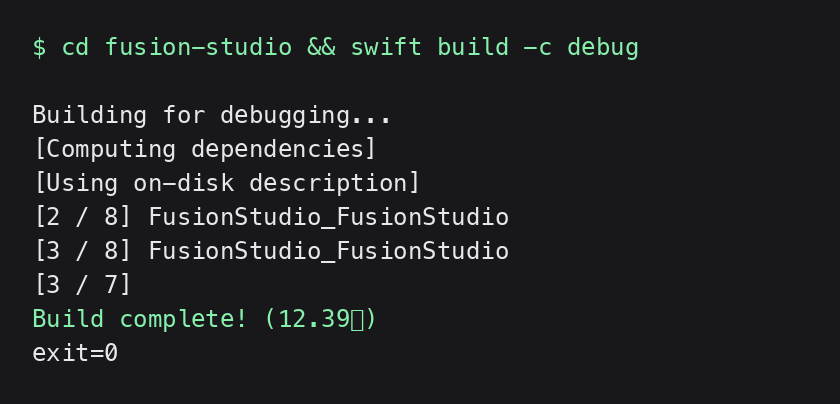

# Fusion Studio 快速上手（Get Started）

> 目标：在本机构建出可运行的 Fusion Studio App，并确认它能连上本地 fusion 后端。

## 1. 前置条件

- macOS 14+，Apple Silicon（`Package.swift` 平台约束 `.macOS(.v14)`）
- Xcode 或 Swift 工具链（`swift` 命令可用）；Rust 为可选项（#296 后本地无 Rust 守护进程）
- Homebrew（`Scripts/setup.sh` 会安装 `cmake` `glfw` `glew`）
- Python3 + venv：优先 monorepo 共享 `~/fusion/.venv`，否则项目本地 `.venv`（`Scripts/setup.sh` 的 OPS-7 约定，不污染系统 pip）

## 2. 一键环境准备

```bash
cd /Users/dahai/fusion/fusion-studio
source ../.venv/bin/activate   # 如存在 monorepo 共享 venv
./Scripts/setup.sh
```

确认点：脚本输出 macOS / Swift / Python 版本，且无 `[ERROR]`。

## 3. 构建与运行

```bash
swift build -c debug     # 日常开发
./Scripts/dev.sh         # 循环重启调试版（杀旧进程后重启）
swift build -c release   # 发布构建
```

确认点（真实构建输出）：



说明：本环境无法对 GUI 窗口截图（无 macOS 会话交互），此处以真实 `swift build` 终端输出代替 App 界面截图；首次启动后 App 窗口为图标栏 + 侧边栏 + 工作区 + 检查器布局（`IconRailView | FusionSidebarView | WorkspaceArea | InspectorPanel`）。

## 4. 连接上游服务

App 自身不含推理与业务守护进程（#296/#298），数据面走中央路由 `daemon_server.py`（fusion-agent-studio，UDS `/tmp/fusion-studio.sock`）与 fusion-mlx（默认 `127.0.0.1:11434`）：

```bash
cd /Users/dahai/fusion/fusion-mlx && ./start.sh status   # 确认 11434 已监听
./Scripts/start.sh status                                # 经 fusion-supervisor 查看全部上游
./Scripts/start.sh start                                 # 拉起上游服务
```

确认点：App 内 Settings → 对应服务健康检查通过；`mlxBaseURL` 解析优先级见 `Common/FusionConfig.swift`（用户覆盖 > 环境变量 > 默认 `127.0.0.1:11434`）。

## 5. 打包分发

```bash
./Scripts/build.sh app        # SPM release 构建 + 拷贝 Info.plist
./Scripts/build.sh package    # app + Python 运行时打入 .app
./Scripts/build.sh sign       # 签名（需签名密钥）
./Scripts/build.sh dmg        # 出 DMG
./Scripts/build.sh all        # 完整流水线
```

- 版本号固定在 `Scripts/build.sh` 顶部 `VERSION`（当前 `0.1.66`），发版前先改它
- 无签名密钥时 tag 用 `vX.Y.Z-beta`；有密钥用 `vX.Y.Z`（CLAUDE.md）

## 6. 测试

```bash
swift test list     # 发现用例（当前约 205 个，XCTest）
swift test          # 本地执行（见下方已知问题）
```

已知限制：本机工具链（Swift 6.3.3 / macOS 26）存在只发现不执行的漂移，权威门槛是 GitHub Actions `macos-14` + Xcode 15.x（`.github/workflows/ci.yml` 的 swift-build / lint / security 三个 job）。

## 常见问题速查

```yaml
troubleshooting:
  - q: { zh: "build.sh 报 Swift 6 并发警告导致 CI 失败", en: "CI fails on Swift 6 concurrency warnings" }
    a: { zh: "并发警告按阻塞处理，给视图/服务补 @MainActor 注解。", en: "Concurrency warnings are blocking; add explicit @MainActor to views and services." }
  - q: { zh: "App 内服务全部离线", en: "All services show offline in the app" }
    a: { zh: "先确认中央路由与 fusion-mlx 已启动，再看 /tmp/fusion-studio.sock 是否存在。", en: "Check the central router and fusion-mlx are up, then that /tmp/fusion-studio.sock exists." }
```

## 提交检查清单

- [x] 所有命令来自 `Scripts/` 与 `Package.swift`，均为真实可执行
- [x] 每步有确认点；无法截图 GUI 已如实说明
- [x] zh/en 成对（命令除外）
